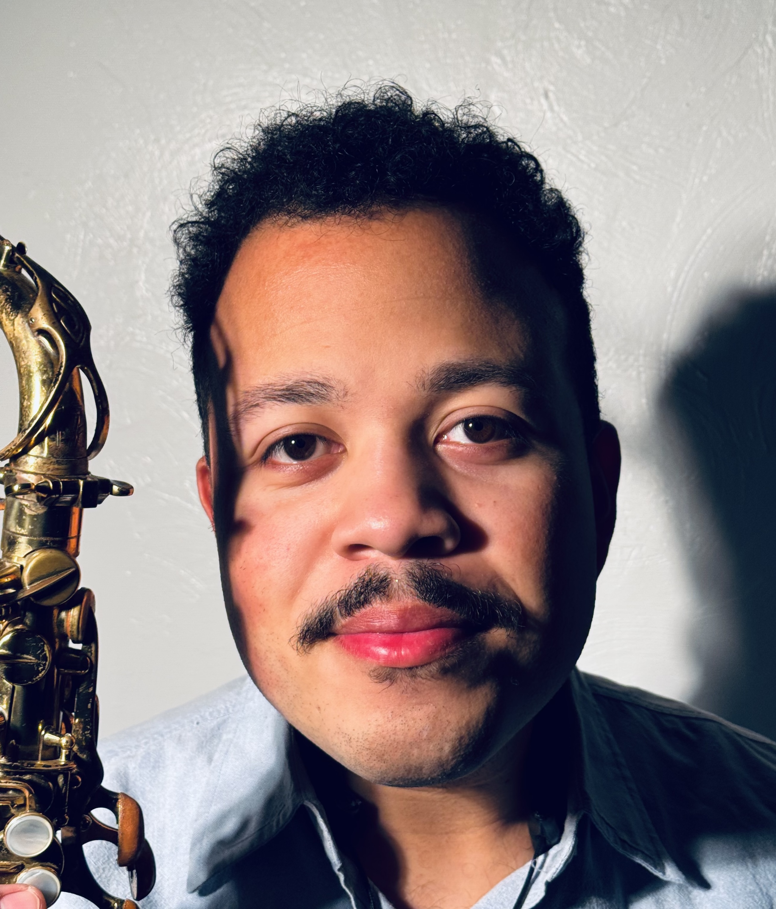

My name is Bryan Medina (he/him) and I'm a postdoctoral fellow at the [Basis Research Institute](https://www.basis.ai), where I'm a member of the Collaborative Intelligent Systems (CIS) team.

{:.content-narrow .content-block}
My Ph.D. research asked how people remember the everyday sounds of the world, and how prior experience shapes what we perceive and remember. In large-scale online experiments, listeners heard a continuous stream of environmental sounds, music, and auditory textures and reported whenever a sound repeated. I then built an ideal-observer model in which a sound's memory trace, stored in a perceptual representation of natural sounds, changes as new sounds are heard and is shaped by a learned prior over natural sounds. Finally, I led cross-cultural studies with listeners in the United States, a small town in Bolivia, and remote Tsimane' communities, using memory errors to ask whether the perceptual similarity of music is shared across cultures.

{:.content-narrow .content-block}
At Basis, I'm interested in whether behavior can give us access to internal state. In rats, the behavior we can measure comes in two streams: calls, such as alarm and social calls, and movement, such as where rats go and how they move between shelter, open ground, and burrows. Internal states like arousal or fear are hidden behind both. I work with multimodal recordings of wild urban rats (audio, plus video and thermal tracking), which capture both streams at once. I'm asking how calls and group movement relate, and how much calls alone can tell us about what a group of rats is doing.

{:.content-narrow .content-block}
I received my Ph.D. in [Brain and Cognitive Sciences](https://bcs.mit.edu/) from [MIT](http://web.mit.edu/), where I worked with [Josh McDermott](http://web.mit.edu/jhm/www/) in the [Laboratory for Computational Audition](http://mcdermottlab.mit.edu/) and with [Ila Fiete](https://fietelab.mit.edu). I was an [NSF Graduate Research Fellow](https://www.nsfgrfp.org/resources/about-grfp/) and an [MIT Dean of Science Fellow](https://science.mit.edu/about/awards/deans-fellowship-program/). I earned my B.S. in Computer Science, Cognitive Sciences, and Mathematics from the [University of Central Florida](https://www.ucf.edu/), and in 2019 I did computational neuroscience research with [Dr. Rob Kass](https://www.stat.cmu.edu/~kass/) at [Carnegie Mellon University](https://www.cmu.edu/).

{:.content-narrow .content-block}
Aside from research, I find much joy in giving back to my community. As an Afro-latino first generation student, I believe it's important to share my successes and failures with those who look and talk like I do. I've volunteered my time teaching and talking to students — on campus and in the community — on how to succeed as an underrepresented minority in STEM. At MIT, I was a [BCS REF (Resource for Easing Friction and Stress)](https://bcsrefs.mit.edu); as a BCS REF, I served as a resource to graduate students in the department, listening to their concerns, aiding in problem solving, and pointing them to resources on campus targeted to their needs. I was also involved with outreach efforts at MIT, particularly the MIT Summer Research Program in Biology ([MSRP](https://biology.mit.edu/program-details-bsg-msrp-bio/)) and the [Quantitative Methods Workshop](https://biology.mit.edu/outreach/quantitative-methods-workshop/), having served as a research mentor, lecturer, and "counselor". At UCF, I was the Vice President of the Cognitive Sciences Club @ UCF, a club I co-founded, and Vice President of the UCF SACNAS chapter, both organizations that continue to strive to make opportunities available to all. I also served as peer advisor through the [Academic Advancement Programs](https://academicsuccess.ucf.edu/aap/), helping students with the graduate school and fellowship process in a 1-1 capacity. I was even a [STEM Ambassador](https://stem.ucf.edu/stem-programs-at-ucf/stem-ambassadors/) at UCF.

{:.content-narrow .content-block}
When I'm not thinking about rats, I'm probably practicing alto saxophone or electric bass, digging through [records](https://www.discogs.com/user/bj_medina/collection?page=1&limit=100&header=1&layout=big), or wondering how jazz musicians manage to listen to each other and improvise together in real time. I also enjoy biking, making [photographs](https://www.instagram.com/by_bjm/), and throwing pottery (poorly). At MIT I was part of the fantastic [Emerson/Harris Program for Private Study](https://mta.mit.edu/music/performance/emersonharris-program-private-study), where I studied with [Mark Zaleski](https://www.markzaleski.com) at [Berklee](https://www.berklee.edu) and the singular [Miguel Zenón](https://miguelzenon.com). I also had a radioshow called 'Brain Waves' that aired twice a month on [WMBR](https://wmbr.org/), the MIT radio station (message me for more details). My Erdős number is 4.
